# CartX Merchant Dashboard — Implementation Plan

**Product:** CartX — Multi-Tenant E-commerce SaaS Platform  
**Module:** Merchant Dashboard (`cartx-merchant-dashboard`)  
**Target Market:** Bangladesh (BDT ৳, Bengali & English)  
**Authoritative Specification:** `CARTX_MERCHANT_DASHBOARD.md` (Version 1.0)  
**Status:** Phase 1 Complete • Phase 2 Complete • Phase 3 Complete (Demo Mode) • Phase 4 Complete (Demo Mode) • Phase 5 Complete (Demo Mode) • Phase 6 Complete (Demo Mode) • Phase 7 Complete (Demo Mode) • Phase 8 Complete (Demo Mode) • Phase 9 Complete (Demo Mode)  

---

## 1. Architectural Architecture & Stack Baseline

| Layer | Selected Technology | Status |
|---|---|---|
| Framework | Next.js 16.4.3 (App Router) with React 19.3.0 | Configured in `src/app` |
| Language | TypeScript 5.x (Strict mode) | Configured in `tsconfig.json` |
| Styling | Tailwind CSS v4.0 (CSS-first `@theme`) | Configured in `src/styles/globals.css` |
| UI Primitives | shadcn/ui (`components.json`, `cn()` utility) | Initialized in `src/components/ui` |
| Iconography | Lucide React | Installed & configured |
| Form & Validation | React Hook Form + Zod | Installed & configured |
| Server State | TanStack Query (`@tanstack/react-query`) | Installed; Provider wrapped in `RootLayout` |
| Testing Engine | Vitest (`vitest run`) | Configured in `vitest.config.mts`, 19 passing tests |
| Shared Backend | Shared Express.js + TypeScript API | External backend service (REST API) |
| Database | PostgreSQL + Prisma ORM | Backend managed (Tenant isolation) |

---

## 2. Multi-Phase Roadmap & Milestones

```mermaid
flowchart LR
    P1[Phase 1: Foundation & Architecture] --> P2[Phase 2: Onboarding & Store Profile]
    P2 --> P3[Phase 3: Products & Inventory]
    P3 --> P4[Phase 4: Orders & Customers]
    P4 --> P5[Phase 5: Payments & Shipping]
    P5 --> P6[Phase 6: Storefront Management]
    P6 --> P7[Phase 7: Marketing & Analytics]
    P7 --> P8[Phase 8: Billing, Team & Support]
    P8 --> P9[Phase 9: Mobile App & Advanced]
```

### Phase 1: Project Setup & Architecture Foundation (COMPLETED)
- [x] Migrate to `src/` hierarchy (`src/app`, `src/components`, `src/features`, `src/lib`, `src/hooks`, `src/types`, `src/config`, `src/styles`, `tests`)
- [x] Configure `@/*` path mapping to `./src/*` in `tsconfig.json`
- [x] Initialize shadcn/ui with `components.json` and `src/lib/utils.ts`
- [x] Define CartX design system tokens in `src/styles/globals.css` (Hex: `#2563EB`, `#1D4ED8`, `#38BDF8`, `#0F172A`, `#F8FAFC`, etc.)
- [x] Configure Google Fonts (`Inter` and `Noto Sans Bengali`) in root layout
- [x] Install essential dependencies: `clsx`, `tailwind-merge`, `class-variance-authority`, `lucide-react`, `zod`, `react-hook-form`, `@hookform/resolvers`, `@tanstack/react-query`, `vitest`
- [x] Implement safe `.env.example` and Zod-validated `src/config/env.ts`
- [x] Create typed API client (`src/lib/api/client.ts`) with tenant header injection (`X-Store-Id`) and structured error handling (`ApiClientError`)
- [x] Create authentication context (`src/lib/auth/context.tsx`) and RBAC permission engine (`src/lib/permissions/rbac.ts`)
- [x] Implement reusable dashboard layout shell (`Sidebar`, `Topbar`, `Breadcrumbs`, `PageHeader`, `EmptyState`, `ErrorState`, `LoadingSkeleton`)
- [x] Implement 16 module navigation groups in `src/config/navigation.ts`
- [x] Add quality scripts to `package.json` (`type-check`, `test`)
- [x] Establish unit test suite in `tests/foundation.test.ts` (100% passing)

---

### Phase 2: Merchant Onboarding & Store Profile (COMPLETED - Demo Mode & Production Deployed)
- [x] **Seven-Step Onboarding Wizard** (`/onboarding/*`):
  - [x] Step 1: Store & Account Identity (`/onboarding/store`) with live debounced slug check & simulated availability engine
  - [x] Step 2: Physical Business Information (`/onboarding/business`) with Bangladesh district select
  - [x] Step 3: Storefront Setup (`/onboarding/storefront`) with brand color picker & theme selector
  - [x] Step 4: First Product (`/onboarding/products`) with BDT price validation & stock
  - [x] Step 5: Payment Setup (`/onboarding/payments`) with Cash on Delivery configuration & zero-trust notice
  - [x] Step 6: Shipping & Delivery (`/onboarding/shipping`) with inside/outside Dhaka delivery charges
  - [x] Step 7: Review & Publish (`/onboarding/publish`) with manual publish confirmation & live URL
- [x] **Store Profile & Settings Management** (`/dashboard/settings`):
  - [x] Store Profile tab (name, subdomain slug, description, storefront URL)
  - [x] Business Information tab (category, address, district, area, trade license)
  - [x] Contact Details tab (owner name, verified email, mobile number)
  - [x] Regional & Localization tab (BDT currency, Bengali `bn-BD` locale, Dhaka timezone)
- [x] **Demo Mode & Public Production Deployment**:
  - [x] `mockOnboardingService` & `mockStoreSettingsService` with SSR-safe `localStorage` persistence
  - [x] Centralized Demo Mode fallback preventing `Failed to fetch` errors
  - [x] Simulated subdomain registry check with reserved keywords protection
  - [x] Dynamic Resume Setup routing directly to the first incomplete step
  - [x] Interactive Topbar `Demo Mode` indicator with one-click data reset
  - [x] Deployed to Vercel production: https://cartx-merchant-dashboard.vercel.app
  - [x] Contact Details tab (owner name, email, Bangladeshi mobile number)
  - [x] Regional & Locale tab (BDT ৳ currency, `bn-BD` locale, `Asia/Dhaka` timezone)
  - [x] `PermissionGuard` access control (`settings.manage` permission)
  - [x] Form discard / reset support & TanStack Query cache invalidation
- [x] **Dashboard Setup Checklist**:
  - [x] Directly derived from real backend draft/store state (0% to 100% progress)
  - [x] Truthful handling if backend endpoint is unreachable
- [x] **Unit Testing & QA**:
  - [x] Added `tests/phase2-onboarding-settings.test.ts` (12 tests covering schemas, slug regex, RBAC, draft derivation)
  - [x] 19/19 tests passing across entire suite

---

### Phase 3: Products & Inventory Management (COMPLETED - Demo Mode)
- [x] Product CRUD with category, variant matrix, and SKU generator (`/dashboard/products`)
- [x] Product search, multi-column sorting, category filters, and stock level filtering
- [x] Responsive product data table with row selection and bulk actions (Archive, Delete)
- [x] 8-section product form with Zod validation, BDT pricing, and margin calculations
- [x] Curated Bangladeshi demo image presets and URL inputs
- [x] Categories taxonomy management and collections curator
- [x] Stocks & Inventory Overview (`/dashboard/inventory`) with 4 KPI cards and 21st.dev health meters
- [x] Stock adjustments modal with 5 change types (restock, return, damaged, lost, correction)
- [x] Inventory movement audit trail (`/dashboard/inventory/adjustments`)
- [x] CSV bulk product import parser and catalog export
- [x] Collapsible sidebar layout shell (adapted from 21st.dev collapsible sidebar reference)
- [x] Full automated test suite in `tests/phase3-products-inventory.test.ts` (25 tests, 44 total across suite)
- [x] Local browser persistence via `localStorage` with SSR-safe memory fallbacks

### Phase 4: Orders & Customer Records (COMPLETED - Demo Mode)
- [x] Order list with multi-column filters, search, and bulk operations (`/dashboard/orders`)
- [x] Order details page, fulfillment workflows, and status state machine (`/dashboard/orders/[orderId]`)
- [x] Returns & refunds management (`/dashboard/orders/returns`)
- [x] Customer database, profile card, order history, tags, notes, and segmentation (`/dashboard/customers`, `/dashboard/customers/[customerId]`, `/dashboard/customers/groups`)
- [x] Printable invoices formatted for Bangladesh merchants (`window.print()`)
- [x] Full automated test suite in `tests/phase4-orders-customers.test.ts` (25 tests, 69 total across suite)

### Phase 5: Local Payments & Courier Logistics (COMPLETED - Demo Mode)
- [x] **Payment Provider Adapters & Service Boundaries**:
  - [x] bKash Tokenized Checkout adapter (`BkashPaymentAdapter`) simulating createPayment, executePayment, and demo OTP/PIN callbacks.
  - [x] Nagad Direct Checkout adapter (`NagadPaymentAdapter`) with payment reference ID and challenge URL boundaries.
  - [x] SSLCommerz Gateway adapter (`SslcommerzPaymentAdapter`) with session keys, gateway redirect URLs, and Order Validation IPN handling.
  - [x] Cash on Delivery adapter (`CodPaymentAdapter`) preserving core Bangladesh COD fulfillment workflows.
  - [x] Provider-agnostic adapter registry (`paymentAdapterRegistry`).
- [x] **Payments & Finance Dashboard Management**:
  - [x] Payment overview and financial KPI cards (`/dashboard/payments`) with volume, pending, refunds, and active methods.
  - [x] Transactions ledger (`/dashboard/payments/transactions`) with multi-field search, filter tabs, date presets, sorting, pagination, and CSV export.
  - [x] Transaction details modal (`PaymentTransactionDetailsModal`) with TrxID, order link, customer info, and demo verification trigger.
  - [x] Payment methods configuration (`/dashboard/payments/methods`) with environment toggle, account ID, and zero-trust credentials notice.
  - [x] Refund request & refund audit ledger (`/dashboard/payments/refunds`) with refundable balance protection, reason requirement, and idempotency keys.
  - [x] Payment settings & webhook reference (`/dashboard/payments/settings`).
- [x] **Courier Provider Adapters & Service Boundaries**:
  - [x] Steadfast Courier adapter (`SteadfastCourierAdapter`) normalizing raw statuses (`in_review`, `in_transit`, `delivered`, `cancelled`).
  - [x] Pathao Courier adapter (`PathaoCourierAdapter`) normalizing Merchant API statuses (`Pickup_Requested`, `Picked_Up`, `In_Transit`, `Delivered`).
  - [x] RedX Delivery adapter (`RedxCourierAdapter`) normalizing Parcel API statuses (`ready_for_pickup`, `pickup_done`, `in_transit`, `delivered`).
  - [x] Courier adapter registry (`courierAdapterRegistry`).
- [x] **Shipping & Courier Management Dashboard**:
  - [x] Shipping overview and logistics KPI cards (`/dashboard/shipping`).
  - [x] Shipment listing (`/dashboard/shipping/shipments`) with status filter tabs, courier filter, search, pagination, and CSV export.
  - [x] Shipment details & tracking timeline modal (`ShipmentDetailsModal`) with interactive transit stepper and cancellation safety.
  - [x] Consignment creation workflow (`CreateShipmentDialog`) pre-filled from eligible orders with duplicate active parcel prevention.
  - [x] Courier connection settings (`/dashboard/shipping/couriers`) with default warehouse pickup addresses.
  - [x] Shipping zones & delivery rates settings (`/dashboard/shipping/settings`) for Dhaka (৳60), Outside Dhaka (৳120), free shipping threshold, and COD fee.
- [x] **Cross-Module Order Integration**:
  - [x] Order details (`/dashboard/orders/[orderId]`) logistics card enhanced with live shipment tracking and consignment creation shortcut.
  - [x] Financial summary card integrated with transaction references, refund status, and gateway refund trigger.
  - [x] Strict invariant preservation: payment verification does NOT imply delivery; consignment creation does NOT imply delivery.
- [x] **Automated Testing & Quality Gates**:
  - [x] Created `tests/phase5-payments-shipping.test.ts` with 37 tests covering schemas, adapters, duplicate prevention, idempotency, refunds, status normalization, cancellation rules, and order integration.
  - [x] **106 / 106 automated tests passing** across entire repository test suite (100% pass rate).
  - [x] **0 ESLint errors**; **0 TypeScript errors**; **36 / 36 routes** prerendered cleanly via Turbopack build.

### Phase 6: Storefront & Domain Management (COMPLETED - Demo Mode)
- [x] **Storefront Overview Dashboard** (`/dashboard/store`):
  - [x] Status switch (Active, Draft, Maintenance, Offline) with live preview link and copy shortcut.
  - [x] Active theme card, typography/color swatches, and customization shortcut.
  - [x] Domain configuration summary and recent activity trail.
- [x] **Theme Library & Visual Customizer** (`/dashboard/store/themes`, `/dashboard/store/themes/customize`):
  - [x] 4 Curated themes (Modern Commerce, Minimal Boutique, Express Superstore, Artisan Craft).
  - [x] Split-pane interactive customizer with Colors, Typography, Homepage Sections, and Header tabs.
  - [x] Responsive viewport switchers: Desktop (100%), Tablet (768px), and Mobile (375px).
  - [x] Real-time live canvas preview updating instantly via React Hook Form `useWatch`.
  - [x] Reset customizations to theme defaults with confirmation.
- [x] **Domain Management & DNS Instructions** (`/dashboard/store/domains`):
  - [x] Default CartX storefront subdomain (`green-harvest.cartx.com.bd`) with permanent Active status.
  - [x] Custom domain registration form with Zod FQDN validation.
  - [x] Truthful demo mode boundaries: verification labeled as *Demo Mode — Verification Pending* and SSL as *Demo / Not Active*.
  - [x] Interactive DNS instructions modal with copyable CNAME and A record rows.
- [x] **CMS Pages & Legal Policy Templates** (`/dashboard/store/pages`, `/dashboard/store/pages/new`, `/dashboard/store/pages/[pageId]/edit`):
  - [x] CMS pages listing with status tabs, search, and delete confirmations.
  - [x] 4 Bangladesh legal templates (Privacy Policy, Terms & Conditions, 7-Day Refund Policy, Shipping Policy).
  - [x] Prominent legal disclaimer callout identifying templates as non-legal draft advice.
  - [x] Markdown content editor, auto-slug generator, status toggle, and SEO metadata.
- [x] **Sidebar Navigation & Quality Gates**:
  - [x] Integrated Storefront navigation group with 4 nested items protected by `storefront.manage` RBAC permission.
  - [x] Active route and subroute highlighting for deep routes.
  - [x] Created `tests/phase6-storefront.test.ts` (34 tests).
  - [x] **154 / 154 automated unit tests passing** (100% pass rate).
  - [x] **0 ESLint errors**; **0 TypeScript errors**; **43 / 43 routes** compiled cleanly via Turbopack build.

### Phase 7: Marketing, Promotions & Analytics (COMPLETED - Demo Mode)
- [x] **Coupon Codes Management** (`/dashboard/marketing/coupons`, `/new`, `/[couponId]/edit`):
  - [x] Coupon CRUD with unique uppercase code generator, percentage and fixed BDT discounts.
  - [x] Minimum spend, max discount cap, usage limits, customer eligibility (VIP, first-time, all).
  - [x] Live voucher visual card preview in coupon editor.
  - [x] One-click clipboard copy with toast feedback.
- [x] **Discounts & Automated Markdowns** (`/dashboard/marketing/discounts`):
  - [x] Storewide, category, and product promotion campaigns.
  - [x] Conflict prevention callout for overlapping discount rules.
  - [x] Reusable discount calculation engine.
- [x] **Flash Sales Drop Engine** (`/dashboard/marketing/flash-sales`):
  - [x] Live countdown ticker component (`FlashSaleCountdown`) with `setInterval`.
  - [x] Allocated vs claimed inventory quota progress bar.
  - [x] Strict business rule validation (discounted < regular price, stock <= inventory, overlap prevention).
- [x] **Marketing Analytics** (`/dashboard/marketing/analytics`):
  - [x] Attributed revenue, redemption velocities, and discount expenditure KPIs.
  - [x] Multi-timeframe filters (Today, 7D, 30D, 90D).
  - [x] SVG campaign trajectory trend chart with interactive tooltip inspection.
  - [x] Best-performing campaigns and top redeemed coupons ranking tables.
- [x] **Product & Campaign Reports** (`/dashboard/marketing/reports`):
  - [x] Tabbed analytical ledgers (Products, Campaigns, Coupons, Discounts).
  - [x] RFC-4180 compliant CSV export engine with native UTF-8 BOM (`\uFEFF`) for Bengali characters.
- [x] **Sidebar Navigation & Quality Gates**:
  - [x] Added collapsible `Marketing` navigation group with 6 implemented routes in `src/config/navigation.ts`.
  - [x] Updated RBAC permissions (`marketing.view`, `marketing.manage`, `discounts.manage`, `reports.view`).
  - [x] Created `tests/phase7-marketing.test.ts` (31 tests).
  - [x] **186 / 186 automated unit tests passing** (100% pass rate across 8 test suites).
  - [x] **0 ESLint errors**; **0 TypeScript errors**; **51 / 51 routes** compiled cleanly via Turbopack build.

### Phase 8: Team, Billing & Operations (COMPLETED - Demo Mode)
- [x] **Team Management & Role-Based Access Control** (`/dashboard/team`, `/dashboard/team/roles`):
  - [x] Team member listing with active status, role badges, joined dates, and last login timestamps.
  - [x] Invite team member dialog with email, role selector (8 merchant roles), and granular permission overrides.
  - [x] Full invitation lifecycle management (Pending, Accepted, Expired, Cancelled, Resend actions).
  - [x] Member edit modal with role modification, permission customization, and status management.
  - [x] Safe member removal with destructive `AlertDialog` confirmation and Store Owner protection (owner cannot be demoted or deleted).
  - [x] Interactive Roles & Permissions matrix view mapping 8 roles against 26 granular permissions across all modules.
- [x] **Billing & Subscription Management** (`/dashboard/billing`, `/plans`, `/invoices`, `/settings`):
  - [x] Subscription tier overview (Starter ৳999/mo, Growth ৳2,499/mo, Pro ৳5,999/mo) with active tier status.
  - [x] Plan comparison matrix with annual billing toggle (17% savings calculation).
  - [x] Upgrade/downgrade subscription dialog with instant tier adjustment simulation and demo mode disclosure.
  - [x] Usage limits tracking with `Progress` bars (products, monthly orders, staff accounts, storage) and warning banners when exceeding 70% threshold.
  - [x] Invoices ledger with status badges (Paid, Pending, Failed), printable tax invoice modal with CartX BD Ltd header, and simulated payment/retry actions.
  - [x] Billing settings & payment instruments management (simulated bKash Auto-Debit, Nagad, Visa/Mastercard).
- [x] **Help Center & Operations Support** (`/dashboard/support`, `/tickets`, `/tickets/[ticketId]`):
  - [x] Help Center landing page with search bar, system operational uptime badge, and Bangladesh e-commerce guides.
  - [x] Categorized FAQ accordion (Shipping, Payments, Domains, Invoicing).
  - [x] Support ticket creation dialog with category and priority selectors.
  - [x] Filterable support tickets ledger with status badges (Open, In Progress, Resolved, Closed).
  - [x] Detailed ticket conversation thread with client reply submission and simulated CartX agent response generator.
- [x] **Sidebar Navigation & Quality Gates**:
  - [x] Added `Team & Access` (2 items), `Subscription & Billing` (4 items), and `Help & Support` (2 items) navigation groups.
  - [x] Created `tests/phase8-team-billing-operations.test.ts` (27 comprehensive tests).
  - [x] Updated `tests/sidebar-navigation.test.ts` (16 tests covering 11 groups and 60 routes).
  - [x] **215 / 215 automated unit tests passing** (100% pass rate across 9 test suites).
  - [x] **0 ESLint errors**; **0 TypeScript errors**; **60 / 60 routes** compiled and prerendered cleanly via Turbopack build.

### Phase 9: Mobile App & Advanced Operations (COMPLETED - Demo Mode)
- [x] **Mobile App Management & Platform Preview** (`/dashboard/mobile-app`, `/branding`, `/content`, `/preview`, `/settings`):
  - [x] Overview dashboard tracking app setup readiness, store package status, and quick customization actions.
  - [x] White-label app branding editor (app name, description, icon, logo, splash screen, 4 brand colors, theme mode).
  - [x] Homepage dynamic layout blocks (hero banners, featured items, category grid, testimonials) and bottom navigation bar router.
  - [x] Responsive dual-device phone emulator for native Android and iOS interactive preview.
  - [x] Compilation settings with package identifiers (`com.store.app`), push notification toggles, and simulated build trigger modal.
- [x] **Advanced Customer Segmentation** (`/dashboard/marketing/segments`):
  - [x] Dynamic audience builder supporting compound AND/OR multi-group condition logic.
  - [x] Deterministic criteria evaluation across 8 fields: orders, spend, AOV, tags, group, last order date, registration date, city/district.
  - [x] Real-time customer count preview and matched customer accounts breakdown.
  - [x] Segment recipe lifecycle management: create, edit, duplicate, toggle status, and delete.
- [x] **Advanced Analytics Hub** (`/dashboard/analytics`, `/sales`, `/customers`, `/products`, `/marketing`):
  - [x] Preset and custom date range filters (Today, 7D, 30D, 90D, Custom range).
  - [x] Sales trends, gross revenue, order volume, and status distribution.
  - [x] Customer acquisition rate, cohort retention, and top high-value VIP customer ledger.
  - [x] Product performance rankings, top revenue SKUs, and inventory reorder alerts.
  - [x] Marketing campaign attribution and voucher savings breakdown.
  - [x] RFC-4180 compliant CSV exports with native UTF-8 BOM (`\uFEFF`) for Bengali characters.
- [x] **Integrations Center & Webhooks** (`/dashboard/integrations`, `/webhooks`):
  - [x] Categorized integration catalog (Payments, Shipping, Marketing, Analytics, Notifications, Storefront).
  - [x] Supported Bangladesh integrations: bKash, Nagad, SSLCommerz, Steadfast, Pathao, RedX.
  - [x] Secure integration config dialogs with zero secrets in client storage.
  - [x] Webhook endpoints management supporting 6 event topics with sample payload previews and simulated test deliveries.
- [x] **Automation & Workflow Builder** (`/dashboard/automation`, `/workflows`, `/new`, `/[workflowId]/edit`, `/history`):
  - [x] Multi-step visual builder for trigger-condition-action recipes.
  - [x] 5 triggers, 5 conditions with operators, and 5 operational actions.
  - [x] Manual execution test simulator with instant audit trail recording.
- [x] **Sidebar Navigation & Quality Gates**:
  - [x] Added `Mobile App`, `Analytics Hub`, `Integrations`, and `Store Automation` navigation groups (15 groups total).
  - [x] Created `tests/phase9-advanced-modules.test.ts` (23 tests).
  - [x] **255 / 255 automated unit tests passing** (100% pass rate across 11 test suites).
  - [x] **0 ESLint errors**; **0 TypeScript errors**; **78 / 78 routes** compiled and prerendered cleanly via Turbopack build.

---

## 3. Definition of Done (DoD) Validation Results

| Gate | Check Command | Status |
|---|---|---|
| **TypeScript Strictness** | `npm run type-check` | **PASS (0 errors)** |
| **ESLint Quality & Rules** | `npm run lint` | **PASS (0 errors, 2 info warnings)** |
| **Automated Test Suite** | `npm run test` | **PASS (255/255 unit tests passing across 11 suites)** |
| **Production Build** | `npm run build` | **PASS (78/78 static and PPR routes prerendered)** |
| **Boundary & Secrets Discipline** | Zero client secrets / zero fake success | **PASS** |
