# CartX Merchant Dashboard — Implementation Plan

**Product:** CartX — Multi-Tenant E-commerce SaaS Platform  
**Module:** Merchant Dashboard (`cartx-merchant-dashboard`)  
**Target Market:** Bangladesh (BDT ৳, Bengali & English)  
**Authoritative Specification:** `CARTX_MERCHANT_DASHBOARD.md` (Version 1.0)  
**Status:** Phase 1 Complete • Phase 2 Complete • Phase 3 Complete (Demo Mode) • Phase 4 Pending  

---

## 1. Architectural Architecture & Stack Baseline

| Layer | Selected Technology | Status |
|---|---|---|
| Framework | Next.js 16.4.3 (App Router) with React 19.3.0 | Configured in `src/app` |
| Language | TypeScript 5.x (Strict mode) | Configured in `tsconfig.json` |
| Styling | Tailwind CSS v4.0 (CSS-first `@theme`) | Configured in `src/styles/globals.css` |
| UI Primitives | shadcn/ui (`components.json`, `cn()` utility) | Initialized in `src/components/ui` |
| Iconography | Lucide React | Installed & configured |
| Form & Validation | React Hook Form + Zod | Installed & configured |
| Server State | TanStack Query (`@tanstack/react-query`) | Installed; Provider wrapped in `RootLayout` |
| Testing Engine | Vitest (`vitest run`) | Configured in `vitest.config.mts`, 19 passing tests |
| Shared Backend | Shared Express.js + TypeScript API | External backend service (REST API) |
| Database | PostgreSQL + Prisma ORM | Backend managed (Tenant isolation) |

---

## 2. Multi-Phase Roadmap & Milestones

```mermaid
flowchart LR
    P1[Phase 1: Foundation & Architecture] --> P2[Phase 2: Onboarding & Store Profile]
    P2 --> P3[Phase 3: Products & Inventory]
    P3 --> P4[Phase 4: Orders & Customers]
    P4 --> P5[Phase 5: Payments & Shipping]
    P5 --> P6[Phase 6: Storefront Management]
    P6 --> P7[Phase 7: Marketing & Analytics]
    P7 --> P8[Phase 8: Billing, Team & Support]
    P8 --> P9[Phase 9: Mobile App & Advanced]
```

### Phase 1: Project Setup & Architecture Foundation (COMPLETED)
- [x] Migrate to `src/` hierarchy (`src/app`, `src/components`, `src/features`, `src/lib`, `src/hooks`, `src/types`, `src/config`, `src/styles`, `tests`)
- [x] Configure `@/*` path mapping to `./src/*` in `tsconfig.json`
- [x] Initialize shadcn/ui with `components.json` and `src/lib/utils.ts`
- [x] Define CartX design system tokens in `src/styles/globals.css` (Hex: `#2563EB`, `#1D4ED8`, `#38BDF8`, `#0F172A`, `#F8FAFC`, etc.)
- [x] Configure Google Fonts (`Inter` and `Noto Sans Bengali`) in root layout
- [x] Install essential dependencies: `clsx`, `tailwind-merge`, `class-variance-authority`, `lucide-react`, `zod`, `react-hook-form`, `@hookform/resolvers`, `@tanstack/react-query`, `vitest`
- [x] Implement safe `.env.example` and Zod-validated `src/config/env.ts`
- [x] Create typed API client (`src/lib/api/client.ts`) with tenant header injection (`X-Store-Id`) and structured error handling (`ApiClientError`)
- [x] Create authentication context (`src/lib/auth/context.tsx`) and RBAC permission engine (`src/lib/permissions/rbac.ts`)
- [x] Implement reusable dashboard layout shell (`Sidebar`, `Topbar`, `Breadcrumbs`, `PageHeader`, `EmptyState`, `ErrorState`, `LoadingSkeleton`)
- [x] Implement 16 module navigation groups in `src/config/navigation.ts`
- [x] Add quality scripts to `package.json` (`type-check`, `test`)
- [x] Establish unit test suite in `tests/foundation.test.ts` (100% passing)

---

### Phase 2: Merchant Onboarding & Store Profile (COMPLETED)
- [x] **Seven-Step Onboarding Wizard** (`/onboarding/*`):
  - [x] Step 1: Store & Account Identity (`/onboarding/store`) with live debounced slug check
  - [x] Step 2: Physical Business Information (`/onboarding/business`) with Bangladesh district select
  - [x] Step 3: Storefront Setup (`/onboarding/storefront`) with brand color picker & theme selector
  - [x] Step 4: First Product (`/onboarding/products`) with BDT price validation & stock
  - [x] Step 5: Payment Setup (`/onboarding/payments`) with Cash on Delivery configuration & zero-trust notice
  - [x] Step 6: Shipping & Delivery (`/onboarding/shipping`) with inside/outside Dhaka delivery charges
  - [x] Step 7: Review & Publish (`/onboarding/publish`) with manual publish confirmation & live URL
- [x] **Store Profile & Settings Management** (`/dashboard/settings`):
  - [x] Store Profile tab (name, subdomain slug, description, storefront URL)
  - [x] Business Information tab (category, address, district, area, trade license)
  - [x] Contact Details tab (owner name, email, Bangladeshi mobile number)
  - [x] Regional & Locale tab (BDT ৳ currency, `bn-BD` locale, `Asia/Dhaka` timezone)
  - [x] `PermissionGuard` access control (`settings.manage` permission)
  - [x] Form discard / reset support & TanStack Query cache invalidation
- [x] **Dashboard Setup Checklist**:
  - [x] Directly derived from real backend draft/store state (0% to 100% progress)
  - [x] Truthful handling if backend endpoint is unreachable
- [x] **Unit Testing & QA**:
  - [x] Added `tests/phase2-onboarding-settings.test.ts` (12 tests covering schemas, slug regex, RBAC, draft derivation)
  - [x] 19/19 tests passing across entire suite

---

### Phase 3: Products & Inventory Management (COMPLETED - Demo Mode)
- [x] Product CRUD with category, variant matrix, and SKU generator (`/dashboard/products`)
- [x] Product search, multi-column sorting, category filters, and stock level filtering
- [x] Responsive product data table with row selection and bulk actions (Archive, Delete)
- [x] 8-section product form with Zod validation, BDT pricing, and margin calculations
- [x] Curated Bangladeshi demo image presets and URL inputs
- [x] Categories taxonomy management and collections curator
- [x] Stocks & Inventory Overview (`/dashboard/inventory`) with 4 KPI cards and 21st.dev health meters
- [x] Stock adjustments modal with 5 change types (restock, return, damaged, lost, correction)
- [x] Inventory movement audit trail (`/dashboard/inventory/adjustments`)
- [x] CSV bulk product import parser and catalog export
- [x] Collapsible sidebar layout shell (adapted from 21st.dev collapsible sidebar reference)
- [x] Full automated test suite in `tests/phase3-products-inventory.test.ts` (18 tests, 37 total across suite)
- [x] Local browser persistence via `localStorage` with SSR-safe memory fallbacks

### Phase 4: Orders & Customer Records (UP NEXT)
- [ ] Order list with multi-column filters, search, and bulk operations
- [ ] Order details page, fulfillment workflows, and status state machine
- [ ] Customer database, order history, tags, and notes
- [ ] Printable invoices and packing slips

### Phase 5: Local Payments & Courier Logistics
- [ ] Bangladesh payment gateways (bKash, Nagad, SSLCommerz) connection settings
- [ ] Bangladesh courier integrations (Steadfast, Pathao, RedX)
- [ ] Automated shipment generation and tracking webhooks

### Phase 6: Storefront & Domain Management
- [ ] Storefront theme library and visual customization
- [ ] Custom domain management and SSL status
- [ ] CMS pages and legal policies

### Phase 7: Marketing, Promotions & Analytics
- [ ] Coupon codes, automatic cart discounts, and flash sales
- [ ] Sales charts, order volume trends, and exportable reports

### Phase 8: Team, Billing & Operations
- [ ] Team invitations and granular permission assignments
- [ ] CartX subscription plans, billing invoices, and usage limits
- [ ] Help center and support ticketing

### Phase 9: Mobile App & Advanced Capabilities
- [ ] White-label merchant/customer mobile app configuration
- [ ] Automated workflows and external webhooks

---

## 3. Definition of Done (DoD) Validation Results

| Gate | Check Command | Status |
|---|---|---|
| Strict TypeScript Compilation | `npm run type-check` | **PASS** (0 errors) |
| ESLint Code Quality | `npm run lint` | **PASS** (0 errors) |
| Automated Unit Testing | `npm run test` | **PASS** (19/19 passed) |
| Next.js Production Build | `npm run build` | **PASS** (14 static routes generated) |
| Boundary & Secrets Discipline | Zero client secrets / zero fake success | **PASS** |
