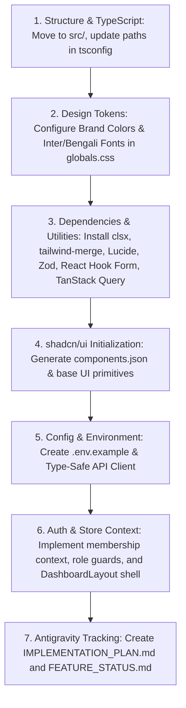

# CartX Merchant Dashboard — Phase 1: Project Setup & Architecture Audit Report

**Document Title:** Phase 1: Project Setup & Architecture Audit Report  
**Target Repository:** `cartx-merchant-dashboard` (`L:\cartx-merchant-dashboard`)  
**Auditor Role:** Senior Frontend Architect & Technical Auditor  
**Date of Audit:** October 28, 2026  
**Baseline Specification:** `CARTX_MERCHANT_DASHBOARD.md` (Version 1.0, Proposed Development Baseline)  
**Final Audit Verdict:** **FAIL** (Clean Scaffolding Baseline, but Incomplete Phase 1 Architecture)

---

## 1. Executive Summary

An architectural and technical audit was conducted on the `cartx-merchant-dashboard` repository against the authoritative product requirements and architectural specifications defined in [`CARTX_MERCHANT_DASHBOARD.md`](file:///L:/cartx-merchant-dashboard/CARTX_MERCHANT_DASHBOARD.md).

The repository is currently at its initial scaffolding stage (Git commit `fcb7f6a8b41f04a3ca34987e4827d263ca804727`: *"Initial commit from Create Next App"*). While the repository succeeds in compiling cleanly and passes default linting, TypeScript checking, and production static site generation using Next.js 16.4.3 and Tailwind CSS v4, **it has not yet established the foundational architecture mandated for Phase 1 ("Foundation & Authentication")**.

### Key Findings Summary:
1. **Repository Structure**: The project is structured directly under the root `app/` directory without the recommended `src/` hierarchy specified in Section 28 of the specification. None of the foundational folders (`components/`, `features/`, `lib/`, `hooks/`, `types/`, `config/`, `tests/`) exist.
2. **shadcn/ui Initialization**: `components.json` is absent. shadcn/ui is neither initialized nor configured. Foundational utility helpers (`cn()`) and core primitives (`clsx`, `tailwind-merge`, `class-variance-authority`, `@radix-ui/*`) are missing.
3. **MCP Tooling**: The **21st.dev MCP** is configured in global settings but is **inaccessible and non-functional** due to a missing `$API_KEY_21ST` environment variable and missing server registration in the active agent runtime. The **shadcn/ui MCP** is completely unconfigured. Conversely, an unrequested MCP (`heroui-react`) is active, presenting architectural drift risks.
4. **Design System & Tokens**: The current styling is the vanilla `create-next-app` dark/light scheme using Geist fonts. None of the CartX brand tokens (Primary `#2563EB`, Hover `#1D4ED8`, Sky `#38BDF8`, Text `#0F172A`, Background `#F8FAFC`, etc.) or typography requirements (`Inter`, `Noto Sans Bengali`) are configured in Tailwind CSS v4.
5. **Backend & Integration Readiness**: There is no API client, no base URL configuration, no authentication layer, no store membership resolution, and no `.env.example` file.
6. **Strict Non-Destructive Validation**: Non-destructive checks (`npm run lint`, `npx tsc --noEmit`, and `npm run build`) all executed with exit code `0`, confirming the base boilerplate is healthy.

**Recommendation:** The project requires a dedicated Phase 1 Foundation setup sprint before any Phase 2 (Merchant Onboarding & Store Profile) implementation can begin.

---

## 2. Project Status & Inspected Files

### 2.1 Repository State
- **Branch:** `main`
- **Latest Commit:** `fcb7f6a` (*Initial commit from Create Next App*)
- **Total Tracked Files:** 17 files
- **Total Lines of Source Code (excluding lockfile):** Boilerplate Next.js starter (~150 LOC)
- **Application State:** Vanilla boilerplate. No application-specific business logic, dashboard layouts, or UI modules have been implemented.

### 2.2 Inventory of Inspected Files & Configurations

| File / Path | Type / Purpose | Audit Observations |
|---|---|---|
| [`CARTX_MERCHANT_DASHBOARD.md`](file:///L:/cartx-merchant-dashboard/CARTX_MERCHANT_DASHBOARD.md) | Authoritative Specification | Complete 2,661-line specification covering all 16 modules, architecture, roles, schema, roadmap, and Antigravity guidelines. |
| [`package.json`](file:///L:/cartx-merchant-dashboard/package.json) | Package Manifest | Declares Next.js 16.4.3, React 19.3.0, Tailwind CSS v4. Lacks shadcn/ui, Lucide, TanStack Query, React Hook Form, Zod, and test scripts. |
| [`package-lock.json`](file:///L:/cartx-merchant-dashboard/package-lock.json) | Lockfile | Locked with npm v11 / Node v26. Consistent with `package.json`. |
| [`tsconfig.json`](file:///L:/cartx-merchant-dashboard/tsconfig.json) | TypeScript Configuration | Strict mode enabled; alias `@/*` points to `./*` instead of `./src/*`. Target set to `ES2017`. |
| [`next.config.ts`](file:///L:/cartx-merchant-dashboard/next.config.ts) | Next.js Configuration | Turbopack CSS loader for Tailwind v4 configured; experimental `agentFeedback`, `cacheComponents`, and `partialPrefetching` enabled. |
| [`eslint.config.mjs`](file:///L:/cartx-merchant-dashboard/eslint.config.mjs) | ESLint Flat Config | Extends `eslint-config-next/core-web-vitals` and `typescript`. Clean and functional. |
| [`next-env.d.ts`](file:///L:/cartx-merchant-dashboard/next-env.d.ts) | Next.js Type Declarations | References Next.js route types and global image types. |
| [`.gitignore`](file:///L:/cartx-merchant-dashboard/.gitignore) | Git Ignore Rules | Standard Next.js ignore rules; correctly includes `.env*`, `node_modules`, `.next`, and build outputs. |
| [`AGENTS.md`](file:///L:/cartx-merchant-dashboard/AGENTS.md) | Agent Instructions | System-generated notice regarding Next.js 16 breaking changes and version-matched docs in `node_modules/next/dist/docs/`. |
| [`README.md`](file:///L:/cartx-merchant-dashboard/README.md) | Default Documentation | Default boilerplate README from `create-next-app`. Has not been adapted for CartX. |
| [`app/layout.tsx`](file:///L:/cartx-merchant-dashboard/app/layout.tsx) | Root Layout | Standard boilerplate loading Geist fonts and wrapping children in generic `<html>`/`<body>`. |
| [`app/page.tsx`](file:///L:/cartx-merchant-dashboard/app/page.tsx) | Root Page | Default `create-next-app` landing page linking to Vercel templates. |
| [`app/globals.css`](file:///L:/cartx-merchant-dashboard/app/globals.css) | Global Stylesheet | Tailwind v4 `@import "tailwindcss";` with basic black/white Geist theme variables. Brand palette absent. |
| `public/` (`file.svg`, `globe.svg`, `next.svg`, `vercel.svg`, `window.svg`) | Static Assets | Boilerplate SVG icons from Next.js template. CartX brand assets absent. |
| `C:\Users\ahanaf\.gemini\config\mcp_config.json` | MCP Configuration | Declares `heroui-react` (stdio via npx) and `21st` (SSE/HTTP via URL with `$API_KEY_21ST`). |

---

## 3. Requirements Compliance Matrix

The following matrix evaluates the repository against the Phase 1 architectural specifications defined in Sections 2, 5, 28, 33, and 34 of [`CARTX_MERCHANT_DASHBOARD.md`](file:///L:/cartx-merchant-dashboard/CARTX_MERCHANT_DASHBOARD.md):

| Requirement Area | Specification Target | Actual Repository State | Compliance Status |
|---|---|---|---|
| **Framework & Router** | Next.js with App Router | Next.js 16.4.3 App Router (`app/`) | **COMPLIANT** |
| **Language** | TypeScript (Strict mode) | TypeScript 5.x with `"strict": true` | **COMPLIANT** |
| **Styling Engine** | Tailwind CSS | Tailwind CSS v4.0 with `@tailwindcss/turbopack` | **COMPLIANT** (Needs tokens) |
| **Folder Architecture** | `src/` modular layout (Section 28) | Root `app/` directory; no `src/` directory | **NON-COMPLIANT** |
| **UI Component System** | shadcn/ui with `cn()` utility | Not initialized; no `components.json`, no `lib/utils.ts` | **NON-COMPLIANT** |
| **Icon Library** | Lucide React | Not installed | **NON-COMPLIANT** |
| **Design System Tokens** | Hex colors: `#2563EB`, `#1D4ED8`, `#38BDF8`, etc. (Section 5.2) | Vanilla black/white theme variables only | **NON-COMPLIANT** |
| **Typography** | Inter + Noto Sans Bengali (Section 5.3) | Geist Sans + Geist Mono configured | **NON-COMPLIANT** |
| **Form Handling** | React Hook Form + Zod | Neither installed | **NON-COMPLIANT** |
| **Server State Management** | TanStack Query (or equivalent API state) | Not installed | **NON-COMPLIANT** |
| **Charts** | Recharts (or equivalent) | Not installed | **NON-COMPLIANT** |
| **API Client & Network Layer** | Shared CartX API client with base URL | No API client or fetch wrapper exists | **NON-COMPLIANT** |
| **Environment Configuration** | `.env.example` with `NEXT_PUBLIC_API_BASE_URL` | No `.env` or `.env.example` file exists | **NON-COMPLIANT** |
| **21st.dev MCP Integration** | Working 21st.dev MCP tool for component discovery | Configured in JSON but inactive and missing API key | **NON-COMPLIANT** |
| **shadcn/ui MCP Integration** | shadcn/ui MCP for component inspection | Not configured in MCP settings | **NON-COMPLIANT** |
| **Quality & Test Tooling** | Vitest/Jest, React Testing Library, Playwright | No test frameworks or scripts configured | **NON-COMPLIANT** |
| **Antigravity Tracking Files** | `IMPLEMENTATION_PLAN.md`, `FEATURE_STATUS.md`, etc. (Section 34) | None created in repository | **NON-COMPLIANT** |

---

## 4. Next.js and TypeScript Configuration Findings

### 4.1 Next.js 16.4.3 & App Router
The project utilizes Next.js version `16.4.3`. As noted in `AGENTS.md`, this major version introduces architectural conventions that diverge from Next.js 14/15:
- **Typed Routing**: In `app/layout.tsx`, the root layout uses `LayoutProps<"/">`, which is generated via `next-env.d.ts` importing `.next/dev/types/routes.d.ts`.
- **Async Request APIs**: Next.js 16 enforces asynchronous access for dynamic APIs (`params`, `searchParams`, `cookies()`, `headers()`). Any future page implementation must `await params` or use the appropriate React hooks.
- **Cache Components & Partial Prefetching**:
  [`next.config.ts`](file:///L:/cartx-merchant-dashboard/next.config.ts) enables:
  ```ts
  cacheComponents: true,
  partialPrefetching: true,
  turbopack: {
    rules: {
      "*.css": {
        loaders: ["@tailwindcss/turbopack"],
        as: "*.css",
      },
    },
  },
  ```
  These settings are cutting-edge and suitable for high-performance static shell delivery (PPR), but require deliberate boundary separation between static shells and dynamic merchant data.

### 4.2 TypeScript Configuration (`tsconfig.json`)
- `"strict": true` is properly enabled.
- `"paths": { "@/*": ["./*"] }` currently maps the `@/` prefix to the root directory `./*`. Once the architecture is migrated to `src/` (per Section 28), this must be updated to `"@/*": ["./src/*"]` to prevent broken imports.
- `"target": "ES2017"` is conservative. While compatible, updating to `"ES2022"` or `"ESNext"` is recommended for modern Next.js 16 and Node 20+ environments.

### 4.3 Missing npm Quality Scripts
[`package.json`](file:///L:/cartx-merchant-dashboard/package.json) currently contains only:
```json
"scripts": {
  "dev": "next dev",
  "build": "next build",
  "start": "next start",
  "lint": "eslint"
}
```
Missing standard enterprise scripts:
- `"type-check": "tsc --noEmit"` (to validate types in CI without triggering a full build)
- `"test"` and `"test:e2e"` (for unit and end-to-end testing per Section 32)
- `"format": "prettier --check ."`

---

## 5. shadcn/ui Readiness Assessment

### 5.1 Initialization Status: NOT INITIALIZED
- `components.json` is missing from the repository root.
- No shadcn/ui configuration has been executed.

### 5.2 Tailwind CSS v4 & Class Merging Setup
- shadcn/ui components require a class merging utility:
  ```ts
  import { clsx, type ClassValue } from "clsx";
  import { twMerge } from "tailwind-merge";

  export function cn(...inputs: ClassValue[]) {
    return twMerge(clsx(inputs));
  }
  ```
  Neither `clsx` nor `tailwind-merge` is installed in `package.json`, and no `lib/utils.ts` exists.
- **Tailwind CSS v4 Compatibility**: Tailwind v4 uses CSS-first configuration via `@import "tailwindcss";` and `@theme`. The traditional `tailwind.config.js` is not used. shadcn/ui CLI requires specific configuration flags (or shadcn canary/v2) to correctly generate CSS variables into `globals.css` rather than trying to write a legacy `tailwind.config.js`.

### 5.3 Design System & Token Readiness
[`CARTX_MERCHANT_DASHBOARD.md`](file:///L:/cartx-merchant-dashboard/CARTX_MERCHANT_DASHBOARD.md) Section 5.2 requires a specific enterprise palette:
- Primary: `#2563EB` (Tailwind blue-600)
- Primary Hover: `#1D4ED8` (Tailwind blue-700)
- Accent / Sky: `#38BDF8` (Tailwind sky-400)
- Main Text: `#0F172A` (Tailwind slate-900)
- Secondary Text: `#64748B` (Tailwind slate-500)
- Page Background: `#F8FAFC` (Tailwind slate-50)
- Surface: `#FFFFFF`
- Border: `#E2E8F0` (Tailwind slate-200)
- Status Colors: Success (`#16A34A`), Warning (`#D97706`), Danger (`#DC2626`), Info (`#0284C7`)

Currently, [`app/globals.css`](file:///L:/cartx-merchant-dashboard/app/globals.css) contains only generic black and white CSS variables (`#ffffff` and `#171717`). The required HSL/OKLCH or hex design tokens for shadcn/ui (e.g., `--primary`, `--primary-foreground`, `--muted`, `--accent`, `--border`, `--radius`) are completely absent.

---

## 6. 21st.dev MCP Integration Assessment

### 6.1 Configuration Inspection
Inspection of `C:\Users\ahanaf\.gemini\config\mcp_config.json` reveals the following MCP server definitions:
```json
{
  "mcpServers": {
    "heroui-react": {
      "command": "npx",
      "args": ["-y", "@heroui/react-mcp@latest"]
    },
    "21st": {
      "url": "https://21st.dev/api/mcp",
      "headers": {
        "x-api-key": "$API_KEY_21ST"
      }
    }
  }
}
```

### 6.2 Status Verification
1. **Configured**: **YES**. A remote HTTP/SSE MCP configuration exists in the global `mcp_config.json` under the identifier `"21st"`.
2. **Accessible to Antigravity**: **NO**. The active agent environment lists only `heroui-react` under active MCP servers (`<mcp_servers>`). The `"21st"` server was not registered or failed connection during agent bootstrap.
3. **Environment Credentials**: **UNSET**. The environment variable `API_KEY_21ST` is not defined on the host system (`$env:API_KEY_21ST` returned null/empty).
4. **Verified Working**: **NO (FAIL)**. The 21st.dev component discovery and inspection tools are completely unusable in the current session.

### 6.3 Extra MCP Finding: HeroUI Conflict Risk
The `heroui-react` MCP server (`@heroui/react-mcp@latest`) is actively connected to Antigravity. However, the CartX Merchant Dashboard specification explicitly mandates **shadcn/ui** and Tailwind CSS. HeroUI (formerly NextUI) introduces an entirely different styling runtime and component abstraction. Using HeroUI components would violate Section 2.1 of the specification.

### 6.4 Architectural Role of 21st.dev
21st.dev is an open-source component distribution registry that builds directly on shadcn/ui and Tailwind CSS primitives.
- **Proper Role**: Discovery and integration of high-complexity compound components (e.g., animated metric trends, advanced filter bars, multi-step onboarding steppers).
- **Architectural Safeguard**: Any component adopted from 21st.dev must be imported as raw code into `src/components/`, rewritten to use the CartX design system tokens (`--primary`, `--border`, etc.), and use the local `cn()` utility. It must never introduce conflicting external styling dependencies.

---

## 7. Dependency and Architecture Findings

### 7.1 Existing vs. Required Dependencies

| Dependency Group | Documented Requirement | Currently Installed | Gap / Action Required |
|---|---|---|---|
| **Core Framework** | Next.js 16+, React 19+ | `next@16.4.3`, `react@19.3.0`, `react-dom@19.3.0` | None. Core runtime is installed. |
| **Styling** | Tailwind CSS v4 | `tailwindcss@^4`, `@tailwindcss/turbopack@^4` | None. Engine installed; needs token config. |
| **Class Merging** | `clsx`, `tailwind-merge`, `cva` | None | **Must be installed** for shadcn/ui. |
| **Icons** | Lucide (`lucide-react`) | None | **Must be installed** (Section 2.1). |
| **Form Handling** | React Hook Form + Zod | None | **Must be installed** (`react-hook-form`, `zod`, `@hookform/resolvers`). |
| **Server State** | TanStack Query (`@tanstack/react-query`) | None | **Must be installed** for API caching and mutation handling. |
| **Data Visualization** | Recharts (or equivalent) | None | **Must be installed** for Section 6.3 sales/orders charts. |
| **Testing** | Vitest/Jest, React Testing Library, Playwright | None | **Must be installed** in devDependencies for Section 32 QA. |

### 7.2 React 19 Peer Dependency Compatibility Risk
Next.js 16 runs on React 19 (`19.3.0`). Certain third-party libraries (especially charting and specialized animation libraries) occasionally declare strict peer dependencies of `react: "^18.0.0"`.
- When installing packages during Phase 1 setup, version tags compatible with React 19 must be specified, or packages must be audited for React 19 compatibility before committing.

### 7.3 Structure Gap: Root `app/` vs. `src/`
Section 28 of [`CARTX_MERCHANT_DASHBOARD.md`](file:///L:/cartx-merchant-dashboard/CARTX_MERCHANT_DASHBOARD.md) explicitly defines the folder hierarchy:
```
cartx-merchant-dashboard/
├── public/
├── src/
│   ├── app/
│   │   ├── (auth)/
│   │   ├── (onboarding)/
│   │   └── dashboard/
│   ├── components/
│   ├── features/
│   ├── lib/
│   ├── hooks/
│   ├── types/
│   ├── config/
│   └── styles/
├── tests/
└── .env.example
```
Currently, all files reside directly in `app/` at the repository root. For a dashboard consisting of 16 complex functional modules and extensive shared features, moving to `src/` is an essential architectural baseline.

---

## 8. Backend Integration Readiness

[`CARTX_MERCHANT_DASHBOARD.md`](file:///L:/cartx-merchant-dashboard/CARTX_MERCHANT_DASHBOARD.md) specifies that CartX utilizes a **Shared Express.js + TypeScript API**, **PostgreSQL**, **Prisma**, and **Redis + BullMQ**.

### 8.1 Current Readiness Assessment
1. **API Base URL Configuration**:
   - Section 2.3 mandates `NEXT_PUBLIC_API_BASE_URL`.
   - Currently, there is no environment configuration, `.env.example`, or runtime config module (`src/config/env.ts`) to validate or supply this endpoint.
2. **Network Client & Interceptors**:
   - There is no configured HTTP client (Fetch wrapper or Axios instance).
   - No request interceptors exist to inject `Authorization: Bearer <token>` or tenant context headers (`X-Store-Id`).
   - No response interceptors exist to handle token refresh (`401 Unauthorized`), rate limiting (`429 Too Many Requests`), or server-side error mapping.
3. **Typed Contracts & Error Handling**:
   - No shared TypeScript interfaces exist for the backend entity models described in Section 27 (`Store`, `Order`, `Product`, `Customer`, `PaymentTransaction`, `Shipment`).
   - No standardized error envelope type exists to consume backend validation responses.
4. **Boundary Integrity (Positive Finding)**:
   - The repository contains no direct database code, no Prisma client in the frontend, and no mock API endpoints posing as production code. The frontend remains cleanly decoupled from backend internals.

---

## 9. Security and Maintainability Risks

### 9.1 Secret Handling & Git Hygiene
- Inspection of the repository and Git history reveals **no exposed secrets, tokens, or credentials**.
- [`.gitignore`](file:///L:/cartx-merchant-dashboard/.gitignore) properly ignores `.env*` files, preventing accidental commits of local environment configurations.
- **Gap**: There is no `.env.example` file to document required client variables without values.

### 9.2 Server vs. Client Boundary Discipline
- Both [`app/layout.tsx`](file:///L:/cartx-merchant-dashboard/app/layout.tsx) and [`app/page.tsx`](file:///L:/cartx-merchant-dashboard/app/page.tsx) are default React Server Components (RSC).
- There is currently no misuse of `"use client"` directives.
- When creating components in Phase 1, strict boundary discipline must be maintained: data tables, complex forms, and dialogs will require `"use client"`, while shell layouts, metadata providers, and static page wrappers should remain Server Components.

### 9.3 Maintainability & Documentation Integrity
- Section 34 of the specification explicitly mandates five tracking documents for Antigravity AI agents:
  1. `IMPLEMENTATION_PLAN.md`
  2. `FEATURE_STATUS.md`
  3. `API_INTEGRATION.md`
  4. `SECURITY_CHECKLIST.md`
  5. `API_GAPS.md`
  None of these tracking artifacts currently exist in the repository.

---

## 10. Validation Commands and Results

All checks were executed in a non-destructive manner without altering any source code, configuration files, or package dependencies:

### 10.1 Command 1: ESLint Validation
- **Command:** `npm run lint`
- **Working Directory:** `L:\cartx-merchant-dashboard`
- **Exit Code:** `0`
- **Output:**
  ```text
  > cartx-merchant-dashboard@0.1.0 lint
  > eslint
  ```
- **Evaluation:** Clean pass. No linting warnings or syntax errors detected.

### 10.2 Command 2: TypeScript Compilation Check
- **Command:** `npx tsc --noEmit`
- **Working Directory:** `L:\cartx-merchant-dashboard`
- **Exit Code:** `0`
- **Output:** *(None - clean completion)*
- **Evaluation:** Clean pass. All existing types and route declarations in `app/` resolve without error.

### 10.3 Command 3: Production Build (Turbopack)
- **Command:** `npm run build`
- **Working Directory:** `L:\cartx-merchant-dashboard`
- **Exit Code:** `0`
- **Output:**
  ```text
  > cartx-merchant-dashboard@0.1.0 build
  > next build

  ▲ Next.js 16.4.3 (Turbopack)
  ✓ Running next.config.ts took 76ms
  - Cache Components enabled
  - Partial Prefetching enabled
  - Experiments (use with caution):
    ✓ agentFeedback

    Creating an optimized production build ...
  ✓ Compiled successfully in 8.5s
    Running TypeScript ...
    Finished TypeScript in 2.9s ...
    Collecting page data using 3 workers ...
    Generating static pages using 3 workers (0/4) ...
    Generating static pages using 3 workers (1/4) 
    Generating static pages using 3 workers (2/4) 
    Generating static pages using 3 workers (3/4) 
  ✓ Generating static pages using 3 workers (4/4) in 496ms
    Finalizing page optimization ...

  Route (app)
  ┌ ○ /
  └ ○ /_not-found

  ○  (Static)  prerendered as static content
  ```
- **Evaluation:** Clean pass. The base Next.js 16 boilerplate successfully compiles and builds static pages via Turbopack.

---

## 11. Categorized Findings

### Critical Findings

#### `FIND-ARCH-01`: Missing `src/` Directory and Standard Directory Hierarchy
- **Severity:** Critical
- **File / Configuration:** Repository root (`L:\cartx-merchant-dashboard`)
- **Evidence:** `Get-ChildItem` reveals `app/` located at the root. No `src/` directory exists. Foundational folders (`components/`, `features/`, `lib/`, `hooks/`, `types/`, `config/`, `tests/`) are completely absent.
- **Why It Matters:** Section 28 of `CARTX_MERCHANT_DASHBOARD.md` mandates a structured modular architecture under `src/`. For an enterprise SaaS with 16 distinct sub-modules, placing everything at root causes severe architectural clutter, import confusion, and circular dependencies.
- **Recommended Fix:** Migrate `app/` into `src/app/`, establish foundational directories (`src/components/`, `src/features/`, `src/lib/`, `src/hooks/`, `src/types/`, `src/config/`, `src/styles/`, `tests/`), and update `tsconfig.json` path alias `@/*` to `./src/*`.
- **Required Before Phase 2:** **YES**

#### `FIND-SHAD-01`: shadcn/ui Not Initialized (`components.json` Missing)
- **Severity:** Critical
- **File / Configuration:** `components.json` (Missing)
- **Evidence:** `Test-Path components.json` returned `False`. No shadcn/ui configuration file, component registry, or `cn()` utility exists.
- **Why It Matters:** The entire UI specification (Sections 2.1, 5.1, 5.4) is architected around shadcn/ui. Without `components.json` and utility functions, no buttons, dialogs, sheets, tables, or inputs can be generated or standardized.
- **Recommended Fix:** Initialize shadcn/ui with Tailwind CSS v4 support, generating `components.json`, configuring CSS variables, and creating `src/lib/utils.ts` with `clsx` and `tailwind-merge`.
- **Required Before Phase 2:** **YES**

---

### High Findings

#### `FIND-DEP-01`: Missing Essential UI, Form, and State Dependencies
- **Severity:** High
- **File / Configuration:** [`package.json`](file:///L:/cartx-merchant-dashboard/package.json)
- **Evidence:** `dependencies` contains only `next`, `react`, and `react-dom`.
- **Why It Matters:** Section 2.1 mandates `lucide-react` for iconography, `react-hook-form` + `zod` for forms/validation, and `@tanstack/react-query` for API state management. Phase 2 (Onboarding & Store Profile) heavily depends on multi-step forms, Zod schemas, and icons.
- **Recommended Fix:** Install `lucide-react`, `clsx`, `tailwind-merge`, `class-variance-authority`, `zod`, `react-hook-form`, `@hookform/resolvers`, and `@tanstack/react-query`.
- **Required Before Phase 2:** **YES**

#### `FIND-MCP-01`: 21st.dev MCP Inaccessible / API Key Unset
- **Severity:** High
- **File / Configuration:** `C:\Users\ahanaf\.gemini\config\mcp_config.json`
- **Evidence:** Server `"21st"` is declared in config, but `$env:API_KEY_21ST` is not set on the operating system. Server `"21st"` is absent from active `<mcp_servers>`.
- **Why It Matters:** The user instructions specify 21st.dev MCP as an active UI resource. Without authentication and registration, AI agents cannot search, inspect, or discover compound components from 21st.dev.
- **Recommended Fix:** Set the valid `API_KEY_21ST` environment variable and ensure the MCP client initializes the remote SSE/HTTP connection, or clarify fallback workflow.
- **Required Before Phase 2:** **YES** (if 21st.dev tooling is required for component generation)

#### `FIND-THEME-01`: Missing CartX Brand Design Tokens in Tailwind v4
- **Severity:** High
- **File / Configuration:** [`app/globals.css`](file:///L:/cartx-merchant-dashboard/app/globals.css)
- **Evidence:** CSS contains only generic black/white tokens (`--background: #ffffff; --foreground: #171717`). None of the brand hex codes from Section 5.2 are present.
- **Why It Matters:** Section 5.2 defines strict brand colors: Primary (`#2563EB`), Primary Hover (`#1D4ED8`), Accent Sky (`#38BDF8`), Text (`#0F172A`), Background (`#F8FAFC`), Success (`#16A34A`), Danger (`#DC2626`), etc. Building components before defining tokens will result in inconsistent ad-hoc styling that requires extensive rework.
- **Recommended Fix:** Define semantic CSS variables in `@theme` and `:root` corresponding to the CartX brand design system in `globals.css`.
- **Required Before Phase 2:** **YES**

#### `FIND-API-01`: Missing API Client, Base URL Configuration, and Env Template
- **Severity:** High
- **File / Configuration:** Root repository / [`package.json`](file:///L:/cartx-merchant-dashboard/package.json)
- **Evidence:** No `.env` or `.env.example` file exists. No API client module (`src/lib/api/`) or environment schema exists.
- **Why It Matters:** Section 2.3 and Section 33 require `NEXT_PUBLIC_API_BASE_URL` and a structured API client for communication with the shared Express backend. Phase 2 requires persisting onboarding and store profile data to the backend.
- **Recommended Fix:** Create `.env.example` declaring `NEXT_PUBLIC_APP_NAME`, `NEXT_PUBLIC_API_BASE_URL`, and `NEXT_PUBLIC_APP_URL`. Create a type-safe API client wrapper with tenant header support.
- **Required Before Phase 2:** **YES**

#### `FIND-AUTH-01`: Missing Authentication, Tenant Context, and Permission Guards
- **Severity:** High
- **File / Configuration:** Missing `src/lib/auth/`, `src/lib/permissions/`
- **Evidence:** No auth context, session state, store switcher provider, or permission checks exist in the codebase.
- **Why It Matters:** Section 3 and Section 33 specify that the dashboard requires role-based access control (Store Owner, Admin, Order Manager, etc.) and tenant/store resolution. Building UI routes without store context will require refactoring all routes later.
- **Recommended Fix:** Establish the store membership context provider, auth token storage abstraction, and `PermissionGuard` component.
- **Required Before Phase 2:** **YES**

---

### Medium Findings

#### `FIND-MCP-02`: Irrelevant MCP Server Configured (`heroui-react`)
- **Severity:** Medium
- **File / Configuration:** `C:\Users\ahanaf\.gemini\config\mcp_config.json`
- **Evidence:** Active `<mcp_servers>` contains `heroui-react` (`@heroui/react-mcp@latest`).
- **Why It Matters:** HeroUI is not part of the project specification. If an AI agent accidentally uses HeroUI components or guidelines, it introduces foreign styling abstractions incompatible with shadcn/ui and Tailwind v4.
- **Recommended Fix:** Document clearly that `heroui-react` must not be used in the CartX Merchant Dashboard codebase, or remove it from the active project MCP configuration.
- **Required Before Phase 2:** No (Operational safeguard)

#### `FIND-MCP-03`: shadcn/ui MCP Missing from Configuration
- **Severity:** Medium
- **File / Configuration:** `C:\Users\ahanaf\.gemini\config\mcp_config.json`
- **Evidence:** The user prompt refers to the "shadcn/ui MCP", but no such server is defined in `mcp_config.json` or active in `<mcp_servers>`.
- **Why It Matters:** shadcn/ui component documentation and schema inspection cannot be queried via MCP; manual documentation or standard CLI workflows must be used instead.
- **Recommended Fix:** If an official or community shadcn MCP server is available, configure it in `mcp_config.json`, or document that standard `npx shadcn@latest` CLI is the official mechanism.
- **Required Before Phase 2:** No

#### `FIND-FONT-01`: Incorrect Fonts Configured (Geist vs. Inter & Noto Sans Bengali)
- **Severity:** Medium
- **File / Configuration:** [`app/layout.tsx`](file:///L:/cartx-merchant-dashboard/app/layout.tsx)
- **Evidence:** Imports `Geist` and `Geist_Mono` from `next/font/google`.
- **Why It Matters:** Section 5.3 explicitly requires `Inter` for primary Latin UI and `Noto Sans Bengali` for Bengali content. Font metrics affect tabular alignment, BDT (৳) currency display, and layout spacing.
- **Recommended Fix:** Update `layout.tsx` to load `Inter` and `Noto_Sans_Bengali` via `next/font/google` with appropriate CSS variables (`--font-sans`, `--font-bengali`).
- **Required Before Phase 2:** No (Recommended during Phase 1 cleanup)

#### `FIND-REACT19-01`: React 19 & Next.js 16 Peer Dependency Risks
- **Severity:** Medium
- **File / Configuration:** [`package.json`](file:///L:/cartx-merchant-dashboard/package.json)
- **Evidence:** Running `react: 19.3.0` on `next: 16.4.3`.
- **Why It Matters:** Some legacy React libraries (e.g. older versions of `recharts`, certain Radix primitives) have strict React 18 peer dependencies. Care must be taken when adding packages to avoid dependency conflicts.
- **Recommended Fix:** Verify that all installed UI packages (`recharts`, `@tanstack/react-query`, Radix primitives) support React 19 before finalizing lockfile changes.
- **Required Before Phase 2:** **YES**

---

### Low Findings

#### `FIND-SCRIPTS-01`: Incomplete Quality Scripts in `package.json`
- **Severity:** Low
- **File / Configuration:** [`package.json`](file:///L:/cartx-merchant-dashboard/package.json)
- **Evidence:** Only `dev`, `build`, `start`, and `lint` scripts are present.
- **Why It Matters:** Section 34 requires executing lint, type-check, tests, and build after each phase. Without explicit npm scripts, verification commands are non-standard.
- **Recommended Fix:** Add `"type-check": "tsc --noEmit"`, `"test": "vitest run"`, and `"test:watch": "vitest"` to `package.json`.
- **Required Before Phase 2:** No

#### `FIND-DOCS-01`: Missing Antigravity Development Tracking Artifacts
- **Severity:** Low
- **File / Configuration:** Repository Root
- **Evidence:** None of the 5 tracking files mandated in Section 34 (`IMPLEMENTATION_PLAN.md`, `FEATURE_STATUS.md`, `API_INTEGRATION.md`, `SECURITY_CHECKLIST.md`, `API_GAPS.md`) are present.
- **Why It Matters:** Multi-phase autonomous AI agent development requires persistent state tracking to maintain feature completeness and prevent duplicate work.
- **Recommended Fix:** Create baseline versions of these tracking files once Phase 1 implementation begins.
- **Required Before Phase 2:** **YES**

---

### Informational Findings

#### `FIND-INFO-01`: Untracked Specification Document in Root
- **Severity:** Informational
- **File / Configuration:** [`CARTX_MERCHANT_DASHBOARD.md`](file:///L:/cartx-merchant-dashboard/CARTX_MERCHANT_DASHBOARD.md)
- **Evidence:** `git status` shows `CARTX_MERCHANT_DASHBOARD.md` is present in the repository root as an untracked file.
- **Why It Matters:** Having the specification in the repository root guarantees that AI agents and developers have permanent, local access to the authoritative requirements without external dependencies.
- **Recommended Fix:** Commit `CARTX_MERCHANT_DASHBOARD.md` to git tracking during the initial repository setup commit.
- **Required Before Phase 2:** No

#### `FIND-INFO-02`: Clean Build and Linting Baseline
- **Severity:** Informational
- **File / Configuration:** Build pipeline
- **Evidence:** `npm run lint`, `npx tsc --noEmit`, and `npm run build` all pass with code 0.
- **Why It Matters:** Confirms there is no pre-existing corruption, syntax errors, or broken dependencies in the repository. The foundation is healthy for extension.
- **Recommended Fix:** None required.
- **Required Before Phase 2:** No

---

## 12. Recommended Fixes Prioritized by Impact



### Phase 1 Remediation Execution Order:

1. **Step 1: Adopt `src/` Directory Structure (Immediate)**
   - Move `app/` into `src/app/`.
   - Create foundational directories: `src/components/`, `src/features/`, `src/lib/`, `src/hooks/`, `src/types/`, `src/config/`, `src/styles/`, `tests/`.
   - Update `tsconfig.json` paths mapping: `"@/*": ["./src/*"]`.

2. **Step 2: Install Core Dependencies (Immediate)**
   - UI Utilities: `clsx`, `tailwind-merge`, `class-variance-authority`, `lucide-react`.
   - Form Management: `react-hook-form`, `@hookform/resolvers`, `zod`.
   - API State: `@tanstack/react-query`.
   - Charts: React 19-compatible charting library (`recharts`).

3. **Step 3: Configure Design System Tokens & Typography (Immediate)**
   - Configure CartX brand colors (`#2563EB`, `#1D4ED8`, `#38BDF8`, `#0F172A`, `#F8FAFC`, etc.) in `src/styles/globals.css`.
   - Replace Geist with `Inter` and `Noto Sans Bengali` in `src/app/layout.tsx`.

4. **Step 4: Initialize shadcn/ui (Immediate)**
   - Initialize `components.json` configured for Tailwind CSS v4 and `src/components/ui`.
   - Add core foundational primitives: `button`, `card`, `dialog`, `sheet`, `dropdown-menu`, `input`, `table`, `badge`, `separator`, `skeleton`.

5. **Step 5: Setup API Client & Environment Variables (Immediate)**
   - Create `.env.example` with `NEXT_PUBLIC_API_BASE_URL` and `NEXT_PUBLIC_APP_NAME`.
   - Implement `src/lib/api/client.ts` with tenant header injection (`X-Store-Id`) and error unwrapping.

6. **Step 6: Implement Auth Context & Dashboard Layout Shell (Immediate)**
   - Implement `StoreMembershipContext` and `PermissionGuard`.
   - Build `DashboardLayout`, `Sidebar` (with 16 menu groups per Section 4), and `Topbar`.

7. **Step 7: Establish Antigravity Documentation Artifacts (Immediate)**
   - Create `IMPLEMENTATION_PLAN.md`, `FEATURE_STATUS.md`, `API_INTEGRATION.md`, `SECURITY_CHECKLIST.md`, and `API_GAPS.md`.

---

## 13. Explicit Out-of-Scope Items for Phase 1

To maintain strict architectural boundaries, the following items are explicitly **out of scope** for Phase 1:
- Implementing the Express.js API backend, database migrations, or PostgreSQL schemas.
- Implementing Phase 2: Multi-step Merchant Onboarding Wizard (`/onboarding/*`) or Store Profile forms.
- Implementing Phase 3: Product CRUD, variant matrices, or inventory tracking.
- Implementing Phase 4: Order processing, fulfillment workflows, or customer details.
- Implementing Phase 5: Payment gateway credentials (bKash, Nagad, SSLCommerz) or courier APIs (Steadfast, Pathao, RedX).
- Implementing Storefront customization, marketing campaigns, or mobile app builders.
- Hardcoding mock data or fake analytics as substitute production data.

---

## 14. Phase 1 Completion Checklist

Before the project can be approved to advance to Phase 2, each item below must be satisfied and verified:

- [ ] Project refactored to `src/` hierarchy with `@/*` mapped to `./src/*`
- [ ] Essential dependencies installed (`clsx`, `tailwind-merge`, `cva`, `lucide-react`, `zod`, `react-hook-form`, `@tanstack/react-query`)
- [ ] shadcn/ui initialized with valid `components.json` compatible with Tailwind v4
- [ ] CartX color tokens and design system variables defined in `globals.css`
- [ ] `Inter` and `Noto Sans Bengali` fonts configured in root layout
- [ ] Reusable `cn()` utility established in `src/lib/utils.ts`
- [ ] Core shadcn/ui primitives generated (`button`, `card`, `dialog`, `input`, `table`, `badge`, `sheet`)
- [ ] `.env.example` created with `NEXT_PUBLIC_API_BASE_URL`
- [ ] Base API client implemented with error handling and tenant context
- [ ] Store context and role-based `PermissionGuard` foundation created
- [ ] Responsive `DashboardLayout` shell implemented (Sidebar, Topbar, Breadcrumbs)
- [ ] `npm run lint`, `npm run type-check`, and `npm run build` pass with 0 errors
- [ ] Antigravity tracking files created (`IMPLEMENTATION_PLAN.md`, `FEATURE_STATUS.md`)

---

## 15. Final Verdict

# **VERDICT: FAIL**

### Verdict Justification:
While the existing repository passes standard build and lint checks, it is exclusively a bare `create-next-app` starter template. None of the foundational architectural requirements specified for **Phase 1 ("Foundation & Authentication")** in `CARTX_MERCHANT_DASHBOARD.md` (Sections 2, 5, 28, 33, and 34) have been implemented. Proceeding to Phase 2 without completing the Phase 1 foundation would result in severe technical debt, inconsistent styling, and fractured routing.

**Next Milestone:** Explicit user approval of this audit report, followed by the execution of the Phase 1 Foundation implementation.

